<div align="center">

# ⚓ Prystan

**Docker, servers and databases in one native window.**

A fast desktop client for managing Docker over local socket, TCP or SSH —
containers, logs, files, terminals, host metrics and a read-only database browser.

[](https://github.com/YuraYarmola/Prystan/releases/latest)
[](LICENSE)
[](https://tauri.app)
[](https://www.rust-lang.org/)

🇺🇦 [Читати українською](README.uk.md)

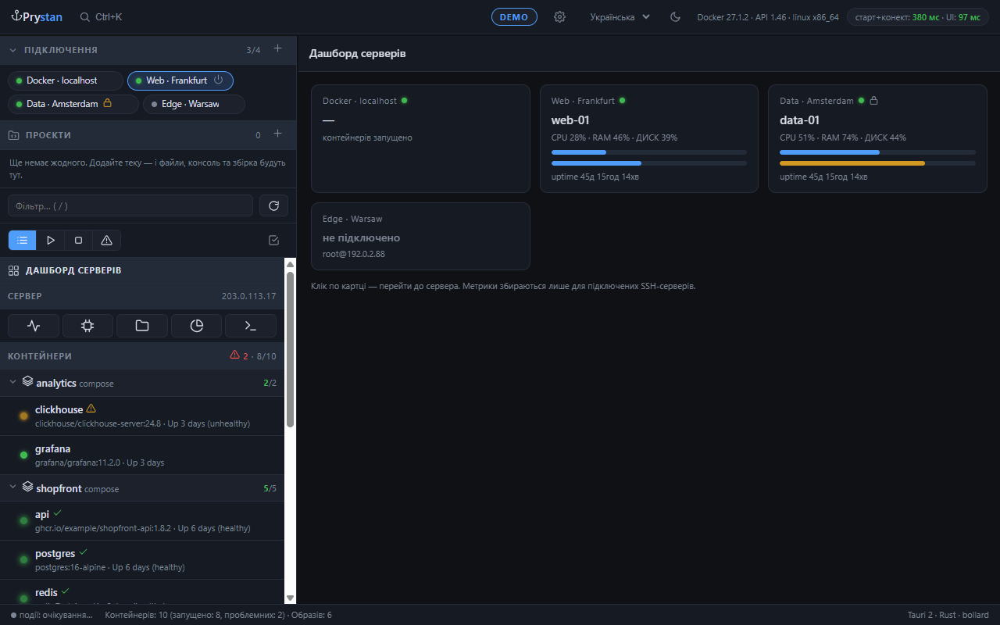

*Every screenshot in this README comes from the built-in **demo mode** — the servers,
containers and addresses in them are invented.*

</div>

---

## New in 0.4.0

Browse **PostgreSQL, MySQL/MariaDB, ClickHouse and Redis** alongside your containers.
Discover databases on the selected server, inspect tables and their sizes, filter
and sort row previews, or explore Redis keys. The embedded Adminer-style interface
uses fixed read operations; successful connections can be remembered securely in
the OS credential store.

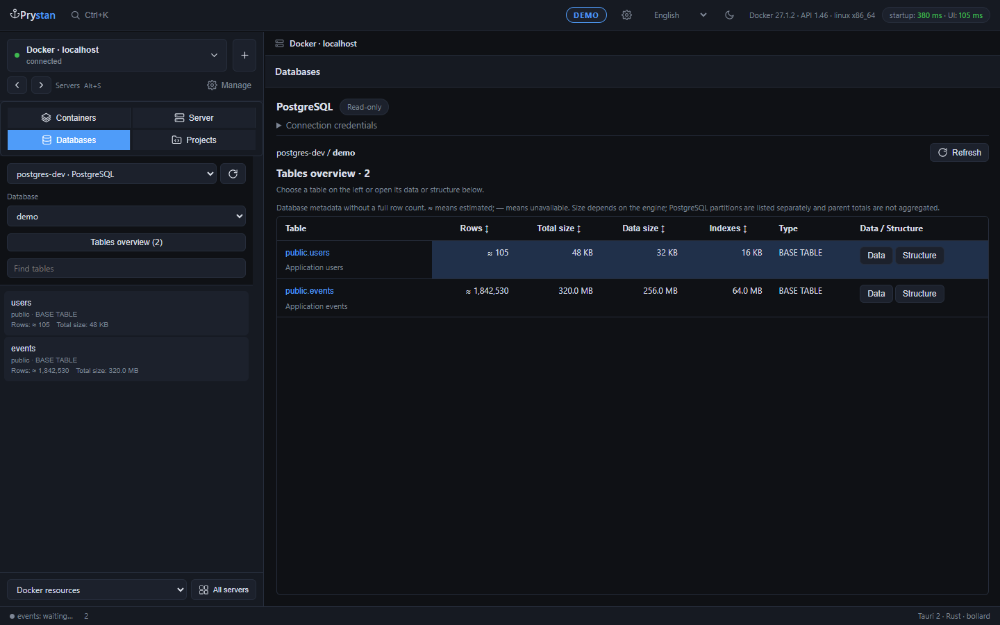

[Database guide](#databases) · [Changes since 0.3.0](CHANGELOG.md#040--2026-10-23) ·
[Download 0.4.0](https://github.com/YuraYarmola/Prystan/releases/tag/v0.4.0)

## Why

Managing containers on several remote servers usually means one of three bad options:
SSH into each box and type `docker` commands by hand, install a web panel *onto* the
production server, or run Docker Desktop and give up 2 GB of RAM.

Prystan is a **roughly 15 MB portable binary**. It connects to Docker daemons
over SSH without installing anything on the server, and puts logs, files, terminals,
host metrics and database previews into one window.

| | Prystan | Docker Desktop | Portainer | lazydocker |
|---|---|---|---|---|
| Install size | **~15 MB** | ~1.5 GB | container | 30 MB |
| RAM idle | **~40 MB** | 1.5–2 GB | server-side | ~20 MB |
| Multi-server over SSH | **✅ built in** | ⚠️ contexts only | agents required | via `DOCKER_HOST` |
| Container file manager + editor | **✅** | basic | limited | ❌ |
| Host monitoring & processes | **✅** | ❌ | ❌ | ❌ |
| Read-only SQL and Redis browser | **✅ built in** | — | — | — |
| Full-history log search | **✅ server-side** | buffer only | buffer only | ❌ |
| Nothing installed on the server | **✅** | — | ❌ | ✅ |

<div align="center">

| Logs with whole-error highlighting | Load across all containers |
|---|---|
| 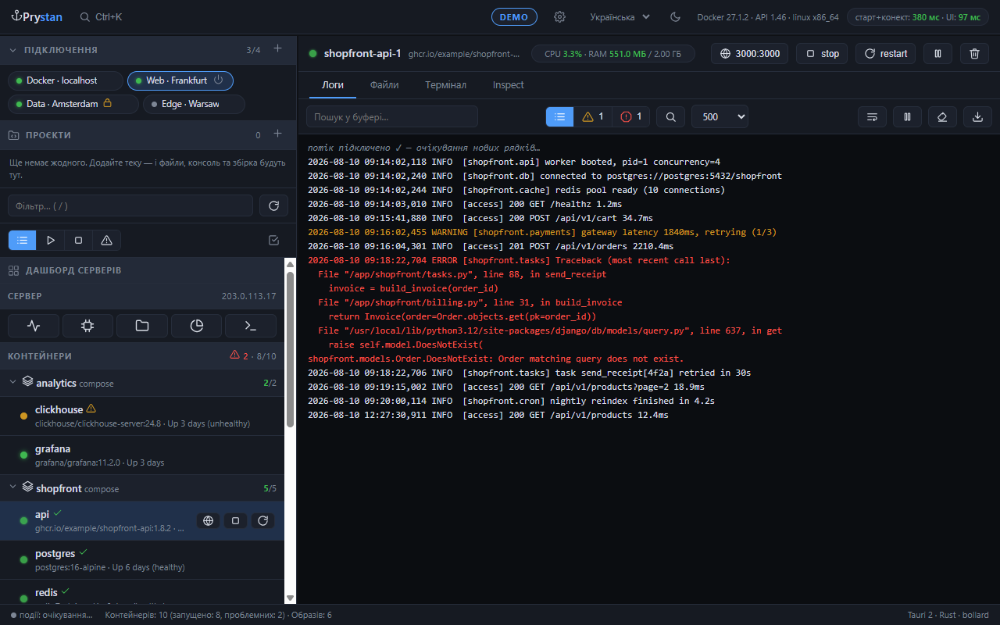 | 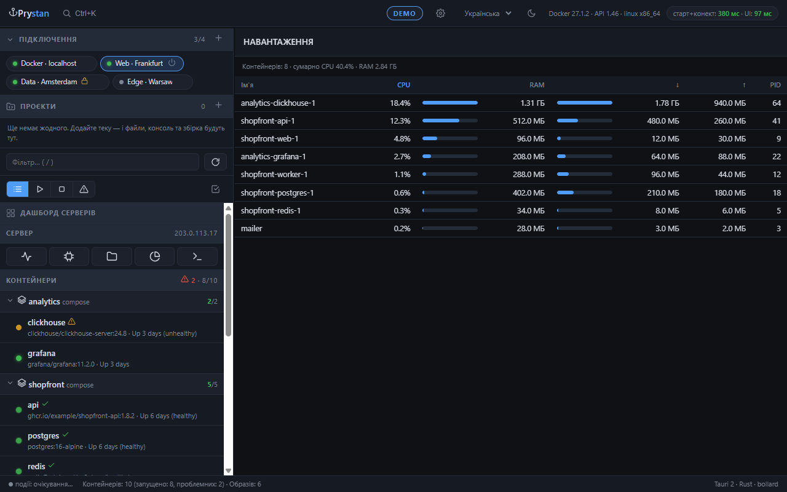 |

| Host files over SSH | Folder sizes |
|---|---|
| 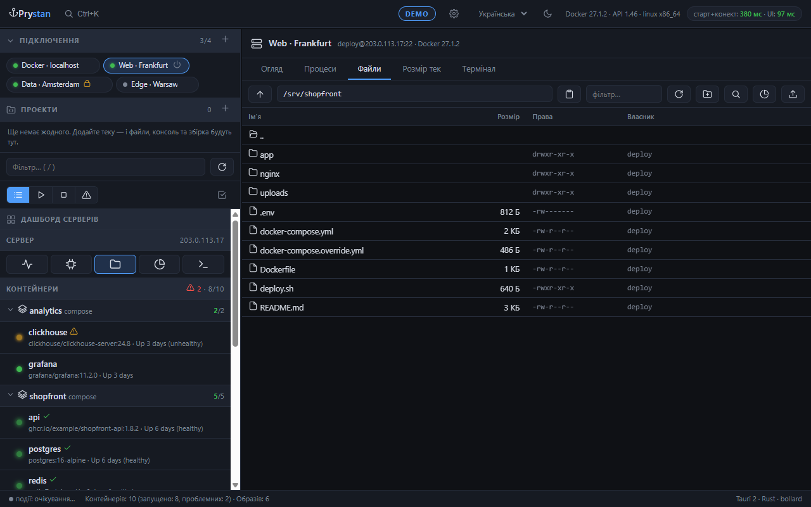 | 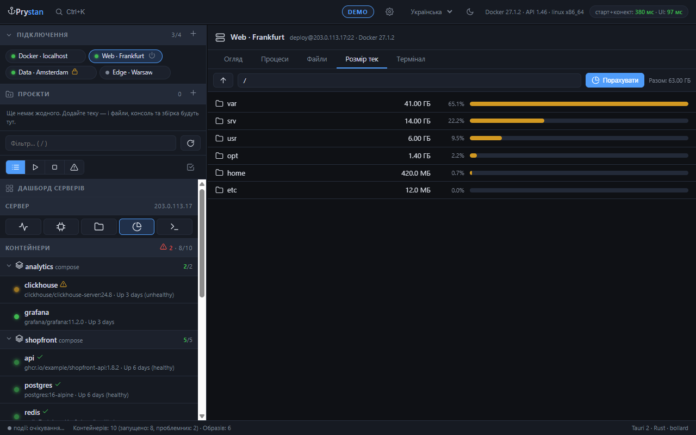 |

</div>

## Download

Builds live on the **[Releases](../../releases)** page — open the latest release and
expand **Assets** at the bottom. Every archive is portable: unpack it and run the
binary, no installer and no runtime to set up.

| Your system | File to download |
|---|---|
| **Windows 10/11** — almost every PC | `Prystan-vX.Y.Z-Windows-x64.zip` |
| Windows on ARM — Surface Pro X, Dev Kit | `Prystan-vX.Y.Z-Windows-ARM64.zip` |
| Windows 32-bit — older machines | `Prystan-vX.Y.Z-Windows-32bit.zip` |
| **Mac with Apple Silicon** — M1 through M4 | `Prystan-vX.Y.Z-macOS-AppleSilicon.tar.gz` |
| Mac with Intel — before 2020 | `Prystan-vX.Y.Z-macOS-Intel.tar.gz` |
| **Linux, 64-bit** | `Prystan-vX.Y.Z-Linux-x64.tar.gz` |

If you are unsure, take **Windows-x64** — it fits almost everyone. The ARM build
simply will not start on a regular PC.

**After downloading**

- **Windows** needs [WebView2](https://developer.microsoft.com/microsoft-edge/webview2/) —
  bundled with Windows 11 and with up-to-date Windows 10.
- **macOS** builds are not signed. On first launch use `Ctrl`+click → *Open*, or run
  `xattr -dr com.apple.quarantine prystan`.
- **Linux** needs `libwebkit2gtk-4.1-0` and `libgtk-3-0`.

> Want a build of the very latest commit rather than a release? Open
> [Actions](../../actions), pick a green run and download the artifact for your
> platform. Those expire after 14 days.

---

# Guide

Every feature, how to switch it on, and how to use it.

## Try it without Docker — demo mode

Open **⚙ → Demo mode** and the app restarts on invented servers, containers, logs and
files. Nothing touches your machine or your infrastructure. Use it to look around
before connecting anything, or to record a screenshot without exposing your own hosts.
A **DEMO** badge in the header shows the mode is on. Turn it off in the same place.

## Connections

**Set up.** Click **＋** next to the current server selector, or take the *SSH server* card on the
start screen.

| Type | What to enter |
|---|---|
| **Local** | nothing — the local socket or named pipe is used |
| **SSH** | host, port, user, optionally a path to a private key |
| **TCP** | host and daemon HTTP port (`2375`); use SSH for encrypted connections |

SSH needs no agent or extra software on the server: the app opens a tunnel with your
own `ssh` client, so anything that works in your terminal works here — including keys
from an agent and settings from `~/.ssh/config`.

**Use.** Open the server selector (**Alt+S**) to search by name or address.
Larger lists use a compact two-column grid. Pinned profiles and recent choices come
first; **★** pins a profile, with the first four pins also available as one-click
sidebar shortcuts. Hover or focus a row for its address and connection details.
Search accepts multiple words; arrow keys select a result and **Enter** opens it. Selecting an offline
profile keeps it offline; press **Connect** when ready. The separate power button
connects or disconnects a profile. Previous/next buttons and **Alt+Up/Down** switch
servers. **Manage** opens the profile editor and context import.

**Container table.** Click **Table** beside the container count for a full-width
list with status, CPU, RAM and ports. Problems appear first by default; click a
column header to sort by name, status, CPU or RAM, and click again to reverse it.
Search and status filters are shared with the sidebar. The log button opens a
container's logs directly, while the menu exposes its existing actions. Bulk
selection stays synchronized with the tree. **Tree**
returns to the previous container detail. Table preference and sorting survive
restart, and each server keeps its table scroll position. Statistics refresh
while the table is open; unavailable readings show a dash. In narrow windows,
ports appear under container names.

The sidebar keeps **Containers / Server / Projects** modes visible. Docker resources
and **All servers** stay at the bottom, independently of list scrolling. Each server
remembers its selected object, detail tab, filters and list position during the session.
A manual disconnect is remembered; enabled profiles reconnect at startup and after
a dropped link, with a growing pause between attempts.

**Read-only** in the profile blocks every mutating action for that server. A good fit
for production: browsing, logs and file viewing stay available. Docker and remote-host
mutations are checked in the backend too. Interactive remote/container terminals and
image scanning are blocked; Compose validation remains available.

**Import** takes existing `docker context` entries and turns them into profiles.

**Right-click the server selector or a picker row** to copy the server's IP,
`user@host` or a ready `ssh` command, or edit its profile.

## Containers

**Use.** Choose **Stacks** or a flat **List**. Click a stack name to open its details;
use its chevron to expand/collapse containers. The toolbar folds all stacks and adds
a container directly. A single container gets logs, a shell, files and inspect.

- Use the **…** button, **Shift+F10**, or **right-click** a container or a stack for the full menu — logs, shell, files,
  inspect, start/stop/restart, copy name or id, delete.
- **Filter** (`/`) matches names, images, projects, **ports**, container ids and
  status text: type `8080` to find who took the port, `exited` to see what fell over.
- **Quick filters** in the toolbar: all, running, stopped, problematic.
- **Bulk mode** (checkbox icon) selects several containers and applies one action to
  all of them.
- **Keyboard**: `↑`/`↓` walk the list, `Enter` opens, `←`/`→` fold a stack, `Del`
  removes, `Space` toggles a bulk selection. Arrow keys act only in the list or its search.

**Indicators.** The dot tells you the state at a glance: healthy pulses green,
unhealthy but still running pulses amber, anything stopped is a steady grey. A
container that crashed three times in ten minutes gets a crash-loop badge.

**Ports.** Every published port is clickable — the button opens a menu when there is
more than one. For an SSH server the app raises a tunnel first, so `localhost` in your
browser reaches the remote port.

## Load

The **LOAD** section shows one table for every running container: CPU, memory,
network in and out, process count. Click a column header to sort — the answer to
"who ate the server" is one glance instead of a walk through containers. The table
refreshes itself while it is open; a click on a row opens that container.

## Logs

**Use.** The log tab streams live and reconnects on its own.

- **Error highlighting understands whole blocks** — a Python traceback or a Java stack
  trace is coloured from its first line to its last, not just the line with the word
  `ERROR`.
- **Level filter** with counters that count incidents, not lines.
- **Search in the buffer** filters visible lines as you type.
- **🔍 Search the full history** asks the server instead of the buffer: plain text or a
  regular expression across everything the container has ever written, with a time
  limit if you need one.
- **Right-click** gives copy of the selection, of one line, of **the whole error**, or
  of the entire buffer, plus export to a file.
- **Follow** pins the view to the tail; scrolling up releases it, the button pins it
  again.
- A compose stack has **aggregated logs** — every service in one colour-coded stream.

**Tune.** The tail size (500 / 2000 / 10000) is next to the toolbar; the in-memory
buffer is in **⚙ → Log buffer**.

## Files

Works the same for a container, a server over SSH, and a local project folder.

**Use.** Double-click opens a folder or a file. The path field is editable — paste a
path and press `Enter`. Drag files from your file manager onto the window to upload.

**Right-click anywhere in the pane** — on a row or on empty space — for open,
download, copy, cut, paste, rename, move, permissions, copy path, new file, new
folder, size analysis and delete. `Ctrl+C` / `Ctrl+X` / `Ctrl+V`, `F2`, `Del` and
`Backspace` do the same from the keyboard.

**Editor.** Syntax highlighting, search inside the file, and a `.bak` copy on save
(the checkbox in the footer). **⚙ → Editor to the side** docks it to the right half
so the logs stay visible while you edit.

**Search** (magnifier in the toolbar) goes recursively through the folder, by file
name or by text inside files, and jumps to whatever you pick.

**Folder sizes** (pie icon) answers "what filled the disk": one level deep with bars,
click a folder to go deeper.

## Terminals

**Use.** Several sessions per container or server, in tabs. For a container pick the
shell in the toolbar (`bash`, `sh`, `ash`, `zsh`); the default is in
**⚙ → Shell**.

- **`Tab`** completes paths — including in shells like `dash` that have no completion
  of their own, where the app does it itself.
- **History suggestions** appear dimmed to the right of the cursor, PowerShell style;
  `→` or `End` accepts one. The 💡 button turns them off.
- **`Ctrl+C`** copies when text is selected and sends the interrupt when it is not.
  **`Ctrl+V`** pastes. Right-click opens copy / paste / select all / clear.
- **Snippets**: save the current command with 💾 and pick it from the dropdown later.
- The host shell runs through a real PTY, so resizing works and `sudo` can ask for a
  password.

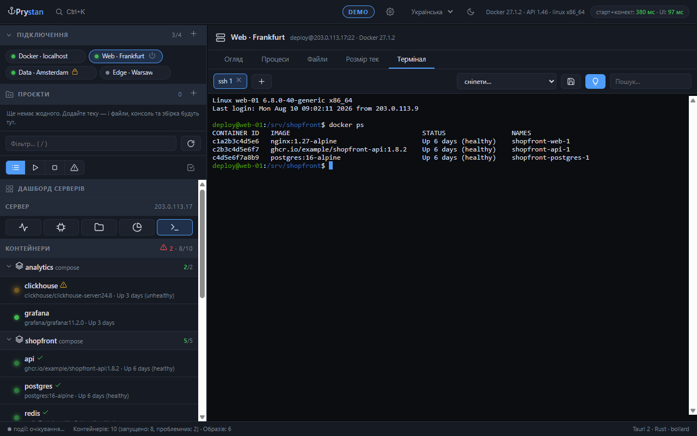

## Server

Available for SSH connections.

- **Overview** — CPU, memory and disks with sparklines, load average, uptime.
  Everything comes from one persistent SSH session, not a command per second.
- **Processes** — a live list with filtering and sorting by CPU or memory, and a kill
  button that sends `TERM` first and `KILL` on a second press.
- **Files** and **Folder sizes** — as described above, on the host filesystem.
- **Terminal** — a full shell.
- **Servers dashboard** shows every configured server on one screen.

## Databases

| Table data, filtering and paging | Columns and table statistics |
|---|---|
| 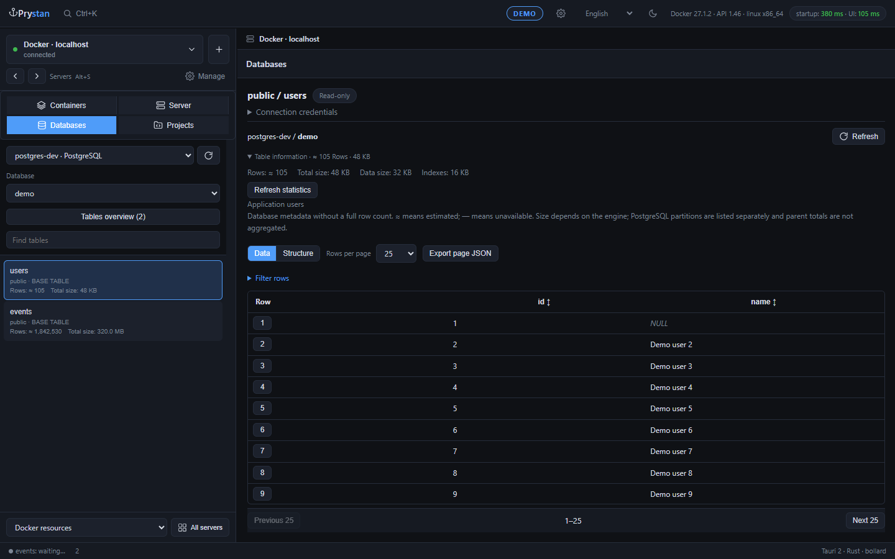 | 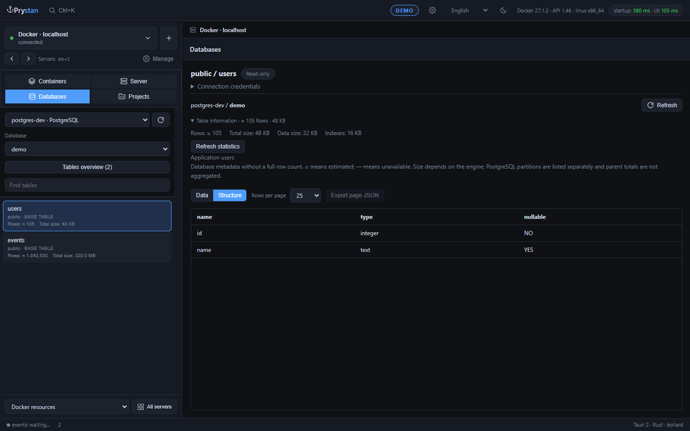 |

| Redis key browser | Remembered connections |
|---|---|
| 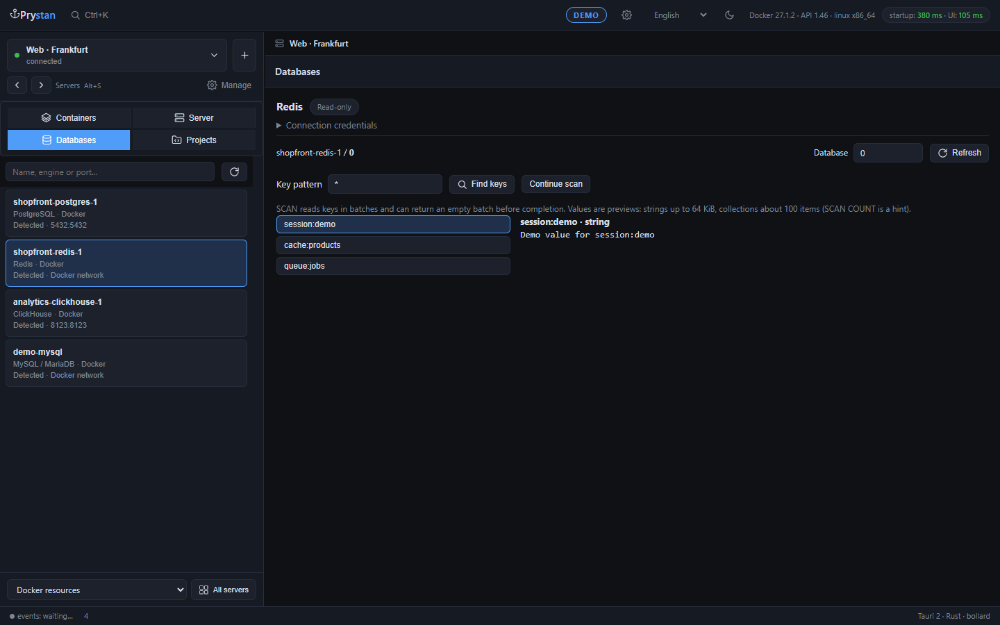 | 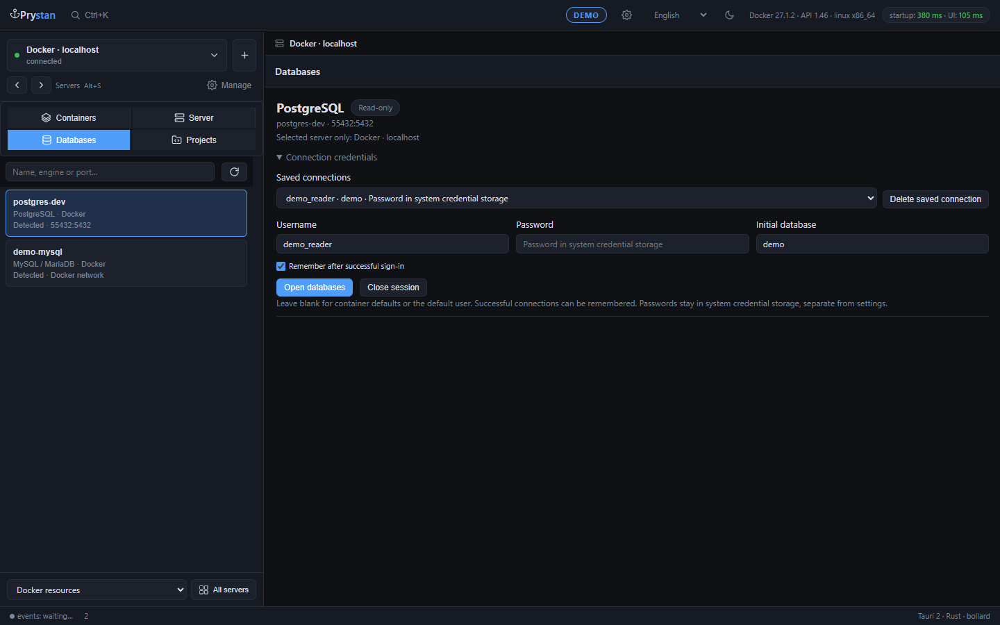 |

Select **Databases** beside Containers, Server and Projects. Prystan discovers
PostgreSQL, MySQL/MariaDB, ClickHouse and Redis containers on the current Docker
endpoint, plus database TCP listeners on SSH hosts. Choose a source, enter optional
credentials and select **Open databases**. Discovery scans only the selected server,
runs Docker and SSH checks in parallel with a six-second discovery budget, and
keeps discovered sources for that connection. Reading tables does not rescan the
server. Use the discovery refresh button after adding or moving a service.
A single running source is selected automatically. A dedicated database server
does not need Docker. PostgreSQL also accepts an initial
database when the account cannot connect to `postgres`.

SQL sources open an Adminer-style browser inside the app: a persistent database
selector and searchable table explorer on the left, a table overview with direct
Data/Structure actions, and a scrollable grid on the right. Open **Filter rows**
to match a column by literal text (equals/contains) or NULL status. Filters run on
the server; click a column heading to sort ascending/descending using its native
type. Choose 25, 50 or 100 rows per page. Opening structure alone does not read rows.
The table overview, sidebar and table description show row counts and sizes from
database metadata. Sort the overview by rows, total size, data size or indexes to
find large tables. PostgreSQL and MySQL row counts are marked as estimates; missing
statistics are shown as a dash rather than zero. PostgreSQL sizes include TOAST
storage and table indexes; partition parents are not aggregated. MySQL reports
engine data/index sizes. ClickHouse exposes its engine-provided total rows and
bytes; separate data/index sizes are unavailable. Views and remote engines may
have no statistics. **Refresh statistics** updates metadata without scanning rows
or running ANALYZE/OPTIMIZE. Database statistics can be stale.
Click a row number for a readable preview of its fields, or use **Export page JSON**
to save the current page with filter/order and truncation metadata. This exports
only the visible preview, including shortened values; credentials are excluded.
ClickHouse bounds each cell preview to at most 256 Unicode
characters and reduces page size for wide tables to stay within the 1 MiB
transport limit. Truncated cells are marked; database values are unchanged.
The pager shows the actual row count per page. Large numbers and decimals are returned as text to preserve
precision. MySQL binary fields are shown as hexadecimal. Without a selected sort,
page order comes from the database. Paging does not use a snapshot; concurrent
changes and equal sort values can shift rows. Metadata lists include up to 2,000
tables. Redis exposes a database number, key-pattern search through `SCAN`, and
bounded previews for strings, hashes, lists, sets, sorted sets and streams. A SCAN
batch can be empty before its cursor reaches zero; use **Continue scan**.

This mode only offers fixed read operations. PostgreSQL uses a read-only session,
MySQL a read-only transaction, ClickHouse `readonly=1`, and Redis an allowlist of
read commands. It works on read-only server profiles. Results stay in memory,
isolated by server. **Remember after successful connection** is enabled by default:
a successful login saves a profile and its password in the OS credential store
(Windows Credential Manager on Windows), with no plaintext fallback. Failed logins
do not overwrite saved credentials. Non-secret account/source metadata is kept in
`database-connections.json` beside server profiles. Saved connections are offered
only for the matching server endpoint and database source; the most recent is
selected automatically. Passwords are resolved by the native backend and never
returned to the UI. Uncheck the option for a session-only connection. **Close
session** clears the live session; **Delete saved connection** also removes its
stored password. If secure saving fails, browsing continues with a visible warning.
For ClickHouse, **Import password from YAML** reads a local file with
`ch_default_password` and/or `ch_admin_password` scalar keys. Choose `default` or
`admin` after import; other secrets are ignored. The file is parsed locally,
never uploaded. A successfully used imported password follows the same remembering
option; unused imported credentials are cleared with the session.

The source must provide `sh`, `timeout` and its native CLI: `psql`, `mysql` or
`mariadb` with JSON functions (MySQL 5.7+/MariaDB 10.2+), `clickhouse-client`, or
`redis-cli` with `--json` support (Redis 6+). Docker queries run inside the source
container, including containers without published ports. Host queries use SSH and
loopback TCP. Discovery reads container metadata and SSH `ss` output (Linux `/proc/net/tcp*`
is a fallback when `ss` is unavailable); it does not
scan application files or extract connection strings. A default port without a
process name is shown as a possible database, not a confirmed engine. Custom
images, socket-only services and TLS-only endpoints may require additional setup;
this mode does not install clients, change services or open external ports.

## Local projects

For the folder you are actually working in.

**Set up.** **＋** next to *PROJECTS* → choose where the folder is:

- **on this computer** — pick it with the **…** button (a native dialog) or paste the
  path; `compose` runs with your local `docker`;
- **on the server** — pick a server, then browse its disk with the **…** button (an
  in-app browser over SSH) or type a path like `/srv/myapp`; files, the editor,
  folder sizes and `compose` all run on that host, and the shell opens directly
  inside the folder. Such a project is marked with a server icon.

A project belongs to the server selected at the time — production gets its folders,
staging its own; "all servers" makes a local project visible everywhere.

**Use.** The project gets its files with the editor, a **shell opened right inside
that folder**, Compose actions executed locally or on its SSH server, and folder size analysis. The badges in the header show what the app found
there: a compose file, a Dockerfile, git.

Read-only on a production profile does not affect **local files and local shells**.
Remote project changes and terminals follow their server's read-only setting. Local
Compose operations follow the local Docker profile's read-only setting.

**Compose actions.** Validate checks configuration without displaying resolved secrets.
Download images and Build images do not restart containers; use Apply afterwards.
Restart uses the existing container configuration. Stop and remove deletes the stack's
containers and networks, keeping volumes. Deployed stacks use their recorded project
name and every recorded Compose file; folder projects use Compose's own project naming
and a detected default override. The file selector chooses which file to open, while
all listed files are passed to the command in order. Output stays available when
switching between targets. Commands use the connection's Docker socket, independently
of the CLI's active context.

Environment edits in the container inspector do not update Compose files or `.env`.
For persistent stack changes, edit those files and Apply. Recreation involves downtime,
keeps existing volumes and image, and attempts recovery on failure. Containers with
static IP settings require a Compose update instead.

## Images and maintenance

- **Layers** — the size of every layer and the command that produced it, so you can
  see what makes the image heavy.
- **Vulnerability scan** — Trivy runs in a throwaway container, nothing leaves the
  host; results are filterable by severity and by "has a fix".
- **Disk usage** with prune per category: images, containers, volumes, build cache.
- **Build** from a Dockerfile, **pull**, **create a container** through a form that
  shows the equivalent `docker run` as you type.
- **Registries**: credentials go into the system keychain, then `push` works from the
  image list.
- **Environment variables** are editable in the Inspect tab exactly like the JetBrains
  plugin does it — the container is recreated with the new values, and the old one is
  restored if anything goes wrong. Secrets are masked until you open them. Every variable is its own line: the buttons
  or the right-click menu copy the name, the real value (even while masked) or
  `KEY=value`; double-click copies the value.
- **CPU and memory limits** change without recreating the container.

| Image layers | Vulnerability scan | Inspect and environment |
|---|---|---|
| 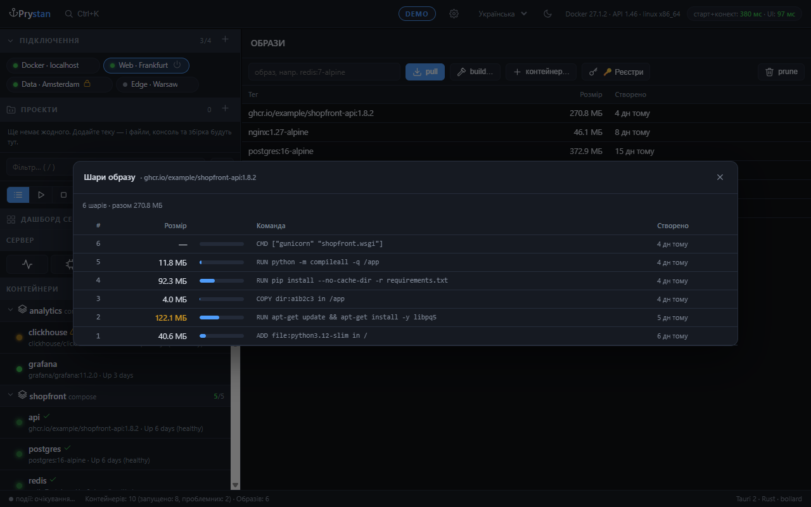 | 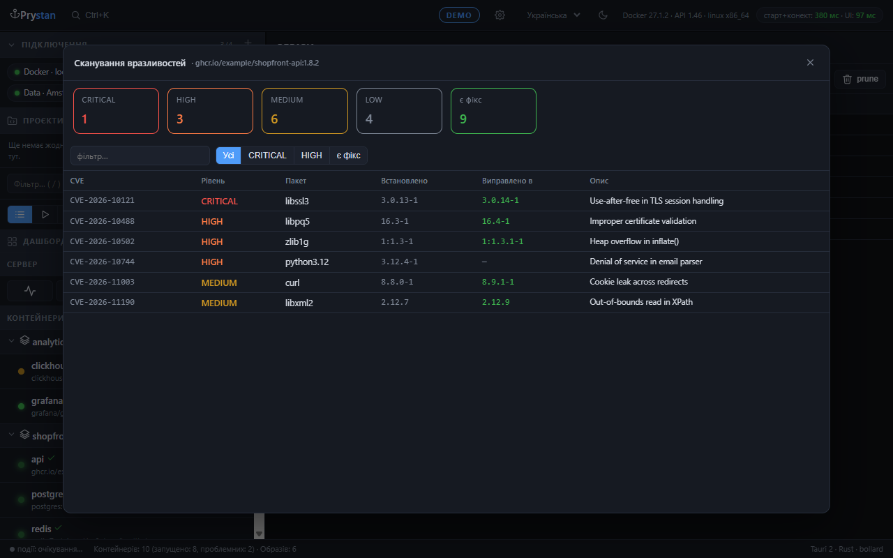 | 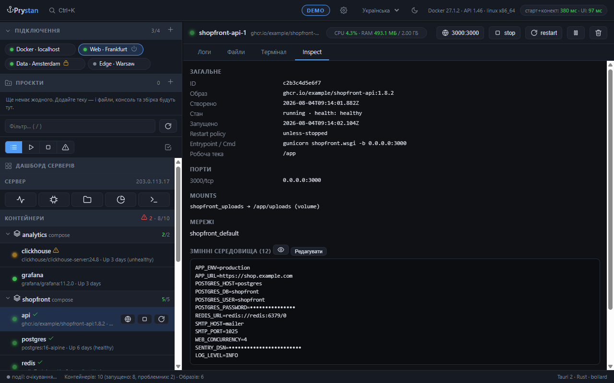 |

## Port forwarding

The globe next to a running container raises an SSH tunnel to the published port and
opens the address in your browser. The 🔌 badge in the header counts open tunnels; a
click closes them all.

## Notifications

**Set up.** **⚙ → Telegram**: paste the bot token from
[@BotFather](https://t.me/BotFather) and press **Find chat** — then write anything to
your bot and the `chat_id` fills itself in. **Send test** confirms it works.

**Choose what to send** — each kind separately:

| Event | When it fires |
|---|---|
| A container stopped unexpectedly | it died and *you* did not stop it; the exit code is included, and `137` is flagged as a possible OOM |
| CPU, memory or disk over the threshold | above 95 % / 92 % / 90 %, at most once per ten minutes |
| Lost connection to a server | the event stream broke |
| A compose action finished | `up`, `down`, `build`, `restart` completed |

**Alerts cover every connected server, not only the one on screen.** Background hosts
are polled on a slow interval — **⚙ → Background monitoring**, where it can also be
turned off.

## Action journal

The **JOURNAL** section records what the app did: which action, on which server, with
which result. Handy when you need to remember what exactly was restarted an hour ago.
Stored locally and clearable.

## Settings

**⚙** in the header:

| Setting | What it changes |
|---|---|
| List refresh | how often the container list is polled (2 / 4 / 10 s, or off) |
| Background monitoring | interval for servers that are not on screen (needed for threshold alerts) |
| Log buffer | how many lines are kept in memory |
| Shell | the default shell for container terminals |
| Ask before deleting | confirmation dialogs for destructive actions |
| Editor to the side | dock the editor instead of covering the window |
| Check for updates | one request to GitHub Releases at startup |
| Indicator animations | the healthy/unhealthy pulse; off saves a little more GPU |
| Demo mode | invented data instead of real |

**Theme** (moon/sun) and **language** (uk / ru / en) are next to the gear.

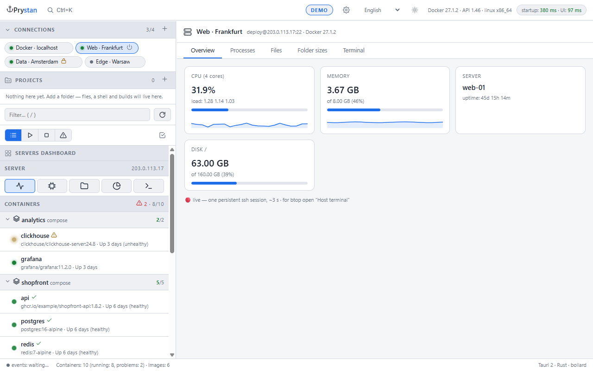

## Keyboard shortcuts

Press **`?`** in the app for this list.

| Keys | Action |
|---|---|
| `Ctrl+K` | command palette — jump to any container, stack, server or action |
| `/` | focus the filter |
| `↑` `↓` · `Enter` | move through the list and open |
| `←` `→` | fold or expand a stack |
| `Ctrl+R` | refresh everything |
| `Del` | delete the selected item |
| `F2` | rename a file |
| `Ctrl+C` / `Ctrl+V` | copy and paste |
| `Ctrl+Shift+A` | select all in the terminal |
| `Backspace` | go up one folder |
| `Esc` | close a dialog or menu |
| `?` | this list |

## Where things are stored

| What | Windows | macOS | Linux |
|---|---|---|---|
| Profiles, database account metadata, projects, journal | `%APPDATA%\Prystan` | `~/Library/Application Support/Prystan` | `~/.config/prystan` |
| Database passwords, registry and Telegram tokens | Credential Manager | Keychain | Secret Service |
| Interface settings | browser local storage inside the app | | |

Passwords and tokens never end up in configuration files.

---

## Build it yourself

Prerequisites:

- [Rust](https://rustup.rs/) (stable, MSVC toolchain on Windows)
- Visual Studio Build Tools with the **C++ workload** (Windows only)
- No Node.js, npm or bundler — the frontend is plain HTML/JS with vendored libraries

```bash
git clone https://github.com/YuraYarmola/prystan.git
cd prystan/app/src-tauri
cargo build --release
```

The binary lands in `app/src-tauri/target/release/prystan.exe`.

```bash
cargo test          # unit tests for parsers
cargo clippy        # lints
```

## Architecture

```
app/
  src-tauri/          Rust backend (Tauri 2)
    src/
      main.rs         connections, profiles, projects, app state
      databases.rs    discovery, fixed SQL/Redis reads, bounded previews
      database_profiles.rs  account metadata and native credential storage
      containers.rs   container list, actions, logs, stats
      logs.rs         history search, aggregated stack logs
      files.rs        container filesystem via archive API
      host.rs         SSH agent, monitor, host files, find, du, compose
      term.rs         container exec sessions
      forward.rs      SSH port forwarding
      resources.rs    images, volumes, networks, registries
      security.rs     Trivy vulnerability scanning
      journal.rs      local action log
      notify.rs       Telegram notifications
      clipboard.rs    native clipboard read
      update.rs       release check
      procguard.rs    guaranteed cleanup of child ssh processes
  ui/                 frontend — plain JS modules, no build step
    js/               core, conn, logs, files, term, server, resources,
                      extras, project, databases, nav, icons, demo
    vendor/           xterm.js, CodeMirror (vendored, no CDN)
```

The backend talks to Docker through [bollard](https://github.com/fussybeaver/bollard)
(Engine API). SSH uses the system `ssh` client: a tunnel for the Docker socket, one
persistent agent process for file operations, and ConPTY for interactive terminals.

## Validation

Run `cargo test --manifest-path app/src-tauri/Cargo.toml` for backend tests and
`node --test tests/*.cjs` for frontend operation contracts (Node 18+).
Two opt-in Docker integration tests cover the original Compose/container flows:
with Docker running and `busybox:1.37` available, run
`cargo test --manifest-path app/src-tauri/Cargo.toml local_ -- --ignored --skip local_database`.
They exercise multi-file Compose deployment, pull without redeployment, environment
recreation, anonymous-volume data preservation, and editor backup/metadata behavior.

A separate database integration test creates four labelled containers with no
published ports and removes only those containers and their anonymous volumes.
Have `postgres:16-alpine`, `mysql:8.4`,
`clickhouse/clickhouse-server:26.8-alpine` and `redis:7-alpine` available, then run
`cargo test --release --manifest-path app/src-tauri/Cargo.toml databases::integration_tests -- --ignored --nocapture`.
It checks metadata, actual data, pagination, decimal precision, authentication and
SQL read-only enforcement against all four engines. On Windows it also checks
secure profile saving, restored authentication, failed-login preservation and
endpoint isolation. To exercise isolated temporary Windows vault entries alone:
`cargo test --release --manifest-path app/src-tauri/Cargo.toml database_profiles::tests::local_ -- --ignored`.
The ClickHouse integration additionally covers bounded previews of large fields.

## Documentation

- [Contributing guide](CONTRIBUTING.md)
- [Security policy](SECURITY.md)
- [Changelog](CHANGELOG.md)

## Contributing

Contributions are welcome — issues, bug reports and pull requests. Every change is
reviewed by the project owner before it lands. Please read [CONTRIBUTING.md](CONTRIBUTING.md)
first; contributions require agreeing to the [CLA](CLA.md).

## License

Prystan is licensed under the **GNU Affero General Public License v3.0** — see [LICENSE](LICENSE).

In short: you may use, study, modify and share it freely, but if you distribute a
modified version or run it as a network service, your changes must be published under
the same license.

Copyright © 2026 Yurii Yarmola. Contributors keep the copyright to their own
contributions and license them to the project under the [CLA](CLA.md), which lets the
project owner also offer Prystan under other terms.
